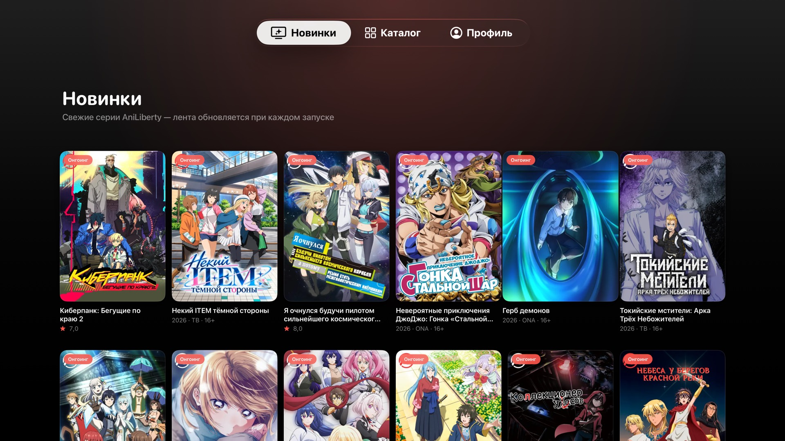
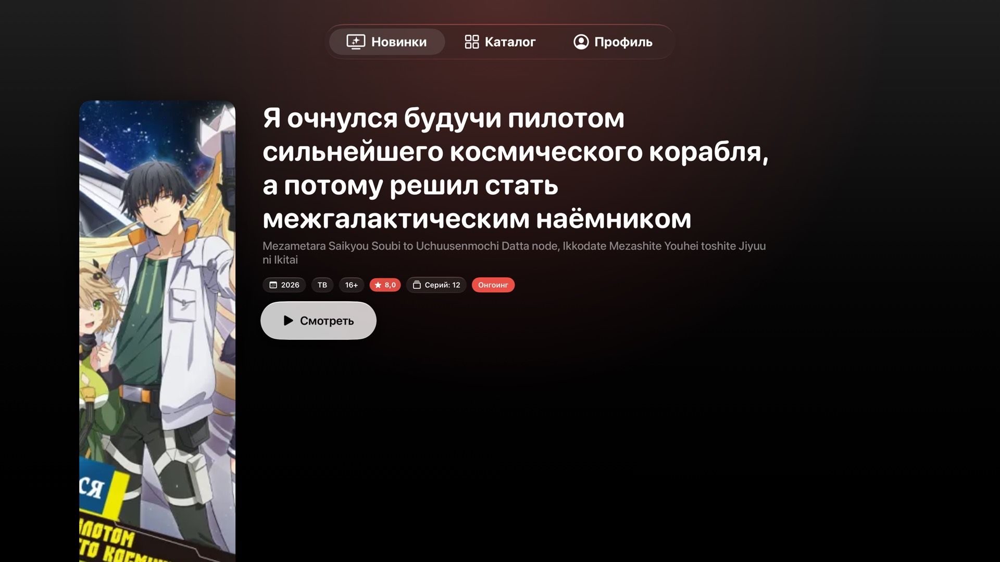
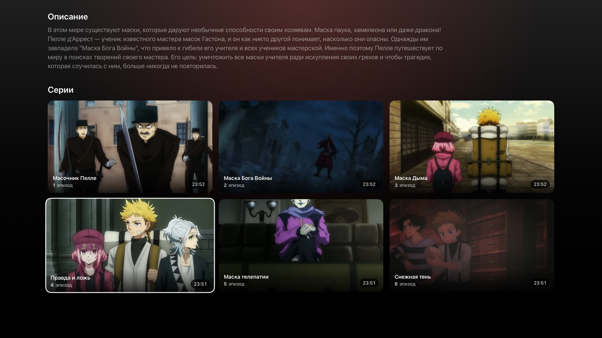
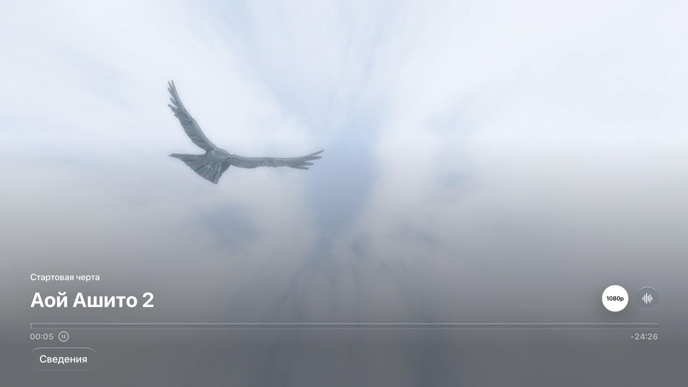
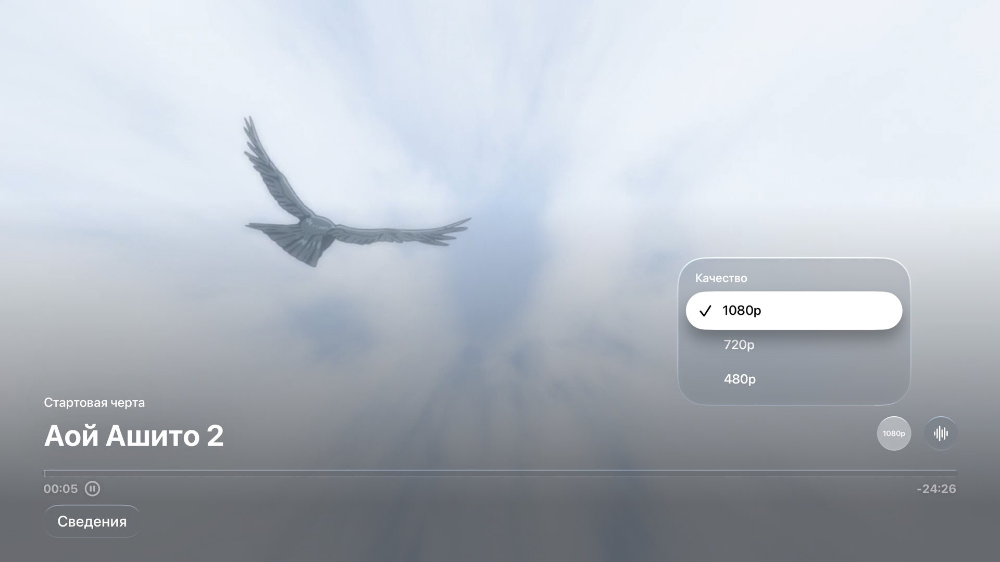
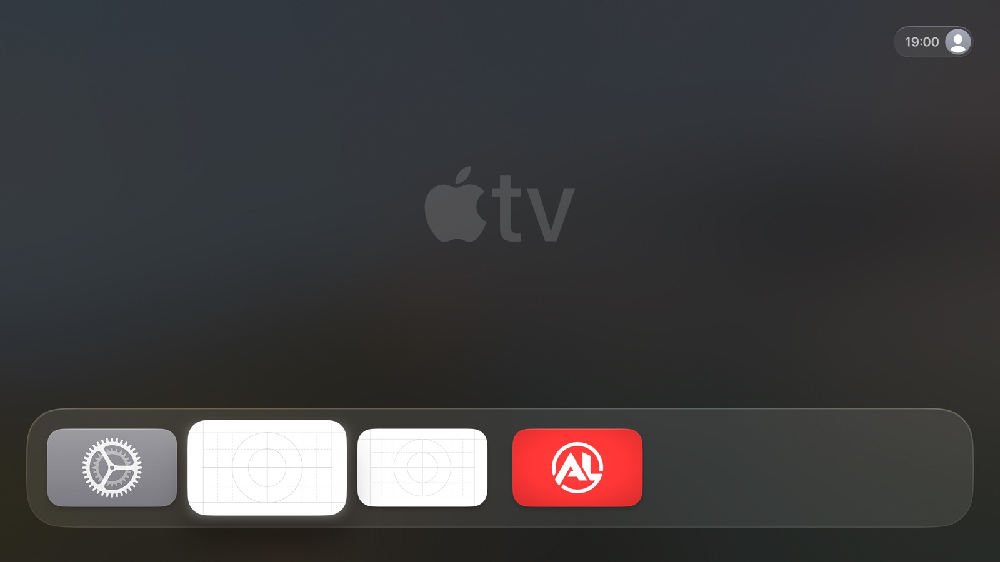

# AniTV

Нативный клиент **Apple TV (tvOS)** для [AniLiberty](https://aniliberty.top) — открытый,
неофициальный проект, написанный на SwiftUI со строгой конкурентностью Swift 6.

> **AniTV не связан с AniLiberty / Anilibria / Libria** и не является их официальным клиентом.
> Название проекта, bundle identifier и оформление не претендуют на роль официального продукта
> сервиса. AniTV не продаётся, не содержит платных подписок и не даёт никаких привилегий в
> сервисе — это обычный просмотрщик поверх публичного HTTP API.

## Содержание

- [Что это](#что-это)
- [Статус проекта](#статус-проекта)
- [Скриншоты](#скриншоты)
- [Требования](#требования)
- [Сборка и запуск](#сборка-и-запуск)
- [Тесты](#тесты)
- [Структура репозитория](#структура-репозитория)
- [Участие в разработке](#участие-в-разработке)
- [Лицензия](#лицензия)

## Что это

AniTV — клиент для просмотра аниме с AniLiberty на Apple TV. Цели проекта:

- **Нативный UI по гайдлайнам Apple.** SwiftUI, TabView/NavigationStack, focus engine,
  Liquid Glass (`glassEffect`, `GlassEffectContainer`) без самодельных блюров.
- **Воспроизведение через системный плеер.** `AVPlayerViewController` с `externalMetadata`,
  таймкодами опенинга/эндинга и сохранением места просмотра.
- **Без сторонних зависимостей.** Сетевой слой, кэш изображений и работа с HLS написаны на
  Foundation/AVFoundation. Список зависимостей в `Package.swift` пуст.
- **Публичный код без секретов.** Токен сессии живёт только в Keychain пользователя, в
  репозитории нет ключей, профилей и подписей.
- **Только публичный API.** Никакого обхода геоблокировок, рекламы и защиты контента.

### Статус проекта

Проект в активной разработке: сборочный пайплайн и ядро `AniLibertyKit` готовы и покрыты
тестами, три основных сценария (лента, карточка релиза, плеер) проходят **UI-тесты на
симуляторе tvOS**, на физическом устройстве приложение ещё не запускалось. Статус в таблице
отражает то, что лежит в репозитории сейчас, а не планы.

Обозначения: ✅ проверено командой · 🚧 код есть, нужна доработка или проверка на устройстве ·
📋 запланировано · 💡 идея, отложена (обоснование — `docs/PROJECT_MEMORY.md`) · ❓ не проверено

| Возможность | Статус | Где живёт |
| --- | --- | --- |
| Генерация проекта из `project.yml` (XcodeGen) | ✅ | `project.yml` |
| Линтер, форматтер, CI-пайплайн | ✅ | `.swiftlint.yml`, `.swiftformat`, `.github/workflows/ci.yml` |
| Контракт публичного API `AniLibertyKit` | ✅ | `docs/SCAFFOLD_CONTRACT.md` |
| Модели API и декодирование (`Release`, `Episode`, `Genre`) | ✅ | `AniLibertyKit/Sources/AniLibertyKit/Models/` |
| HTTP-клиент: эндпоинты, кэш ответов, типизированные ошибки | ✅ | `AniLibertyKit/Sources/AniLibertyKit/API/` |
| Кэш постеров (`ImageCache`, actor; память и диск) | ✅ | `AniLibertyKit/Sources/AniLibertyKit/Cache/` |
| Резолвер HLS-потоков и таймкодов опенинга/эндинга | ✅ | `AniLibertyKit/Sources/AniLibertyKit/Player/` |
| Экран «Последние релизы»: сетка постеров, состояния загрузки | ✅ | `App/Sources/Features/Latest/` |
| Карточка релиза: описание, жанры, список серий | ✅ | `App/Sources/Features/Detail/` |
| Плеер: `AVPlayerViewController`, `externalMetadata`, переключение качества | ✅ | `App/Sources/Features/Player/` |
| Дизайн-система: токены, стеклянные плашки, focus-стили | ✅ | `App/Sources/Design/` |
| Пропуск опенинга/эндинга по таймкодам | 🚧 | `App/Sources/Features/Player/` |
| Избранное на стороне сервера | 📋 | `AniLibertyKit/Sources/AniLibertyKit/API/` |
| Поиск и каталог по жанрам | 📋 | `App/Sources/Features/` |
| Иконка приложения и статичный Top Shelf | ✅ | `App/Resources/Assets.xcassets/` |
| Динамический Top Shelf: карусель свежих релизов (TV Services) | 💡 | `docs/PROJECT_MEMORY.md` |
| Локализация ru/en (String Catalogs) | ✅ | `App/Resources/Localizable.xcstrings` |
| Сборка приложения под симулятор tvOS (`generic/platform=tvOS Simulator`) | ✅ | `project.yml`, `App/` |
| UI-тесты XCUITest: лента → карточка → серии → плеер, переключение качества | ✅ | `App/UITests/` |
| Подпись и установка на устройство (бесплатный аккаунт) | 📋 | `project.yml` |

Значок ✅ у модулей `AniLibertyKit` означает, что `swift test --package-path AniLibertyKit`
проходит локально (25 тестов в 4 сьютах, без сети — на фикстурах из `Tests/…/Fixtures`).
Строки со 🚧 — код есть, но поведение на симуляторе/устройстве в рамках этой итерации не
проверялось; сборка зелёная, но UI ещё не проходили руками.

Строка про UI-тесты — ✅ по локальному прогону (текущая версия с двумя тестами: `Test Succeeded`,
2 из 2; до неё дважды прогонялась версия с одним тестом). На GitHub-раннере этот job ещё ни разу
не выполнялся: в CI он помечен как advisory и не является блокирующей проверкой.

Известные ограничения платформы и аккаунта (влияют на дизайн, а не являются временными
проблемами) перечислены в [AGENTS.md](AGENTS.md) §2 — среди них отсутствие App Groups, CloudKit и
push-уведомлений, потому что разработка идёт на бесплатном аккаунте Apple Developer.

## Скриншоты

Кадры сняты с работающего приложения на симуляторе tvOS 27.2 **этими же UI-тестами** (вложения
`XCTAttachment` из зелёного прогона, `docs/screenshots/`), данные — настоящий ответ API AniLiberty.

| Лента «Новинки» | Карточка релиза | Список серий |
| --- | --- | --- |
|  |  |  |

| Плеер (транспорт-бар) | Качество в транспорт-баре |
| --- | --- |
|  |  |

| Домашний экран tvOS: иконка и Top Shelf при фокусе |
| --- |
|  |

## Требования

- **macOS** с Xcode, в комплекте которого есть **tvOS SDK 26.0 или новее** (проект проверен на
  Xcode 27.2 / tvOS SDK 27.2, Swift 6.4).
- **XcodeGen 2.46.0** — CI ставит ровно эту версию из GitHub release; `brew install xcodegen`
  даст более новую. Файл `AniTV.xcodeproj` не коммитится: он генерируется из `project.yml`
  (см. [ADR 0004](docs/DECISIONS.md)).
- **SwiftFormat 0.64.6** и **SwiftLint 0.65.1** — распинуты так же, из releases (не из Homebrew).
  Версии зафиксированы в комментариях конфигов: правила подобраны и проверены именно на них.
- **xcbeautify 3.2.1** — для читаемого вывода `xcodebuild`; CI берёт universal-сборку из release.
- Симулятор tvOS: в рантайме tvOS 27.2 устройства называются `Apple TV 4K (4th generation)`;
  симулятора `3rd generation` в этом рантайме нет.

## Сборка и запуск

Проект генерируется, а не редактируется руками:

```bash
xcodegen generate
```

Сборка приложения для симулятора tvOS:

```bash
xcodebuild -project AniTV.xcodeproj -scheme AniTV \
  -destination 'platform=tvOS Simulator,name=Apple TV 4K (4th generation)' \
  -derivedDataPath .build/DerivedData build | xcbeautify
```

Для стабильности лучше указывать UDID устройства, а не имя:

```bash
xcodebuild -project AniTV.xcodeproj -scheme AniTV \
  -destination 'id=1CEE9693-F8EB-45A4-8223-1679EE0EFC5A' \
  -derivedDataPath .build/DerivedData build | xcbeautify
```

Запуск в симуляторе:

```bash
xcrun simctl boot "Apple TV 4K (4th generation)"
xcrun simctl install booted .build/DerivedData/Build/Products/Debug-appletvsimulator/AniTV.app
xcrun simctl launch --console-pty booted tv.anitv.client
```

Эта команда проверена в текущем окружении: `xcodegen generate` и
`xcodebuild ... -destination 'generic/platform=tvOS Simulator' CODE_SIGNING_ALLOWED=NO build`
завершаются успехом (BUILD SUCCEEDED). Именно её использует CI, поэтому имя симулятора не нужно.

Перед отправкой изменений форматирование и линт обязательны:

```bash
swiftformat .
swiftlint --strict
```

## Тесты

Тесты живут внутри SPM-пакета и запускаются на хостовом тулчейне, без симулятора и без сети:

```bash
swift test --package-path AniLibertyKit
```

Фикстуры реальных ответов API лежат в `AniLibertyKit/Tests/AniLibertyKitTests/Fixtures/` и
подключаются через `Bundle.module` — в CI сеть не используется.

### UI-тесты (XCUITest)

`App/UITests/LatestFeedUITests.swift` содержит два сквозных сценария: лента грузится, нажатия
пульта через `XCUIRemote` двигают фокус на постер, Select открывает карточку релиза, Menu
возвращает в ленту; второй сценарий с карточки запускает плеер и выходит из него по Menu. Тесты
ходят в **настоящий API AniLiberty** (иначе ленте нечего показать) и требуют поднятого симулятора
tvOS:

```bash
# UDID смотрите в `xcrun simctl list devices available`
xcodebuild test -project AniTV.xcodeproj -scheme AniTV \
  -only-testing:AniTVUITests \
  -destination 'platform=tvOS Simulator,id=1CEE9693-F8EB-45A4-8223-1679EE0EFC5A' \
  -derivedDataPath .build/DerivedData | xcbeautify
```

В CI это отдельный job `ui-tests`. Он **advisory**: падение теста не красит весь workflow и не
блокирует PR (`.xcresult` уходит артефактом, в summary появляется предупреждение). Так сделано
сознательно: сценарий зависит от живого API апстрима и от загрузки симулятора tvOS, а на
GitHub-раннере он пока ни разу не запускался. Красным этот job становится только при сбое самого
раннера (не скачался инструмент, не сгенерировался проект) — то есть по причине, не связанной с
изменением в PR. В required его переведут после серии зелёных прогонов на раннере.

## Структура репозитория

```
AGENTS.md                  рабочее соглашение для людей и AI-агентов
docs/                      память проекта, решения (ADR), заметки об API
project.yml                описание Xcode-проекта (источник истины, XcodeGen)
.github/workflows/ci.yml   сборка + тесты + формат + линт, плюс advisory UI-тесты на macOS-раннере
AniLibertyKit/             общий SPM-пакет: модели, API, кэш, плеер
  Package.swift
  Sources/AniLibertyKit/
    Models/                Codable-модели ответов API
    API/                   эндпоинты, транспорт, маппинг ошибок
    Cache/                 акторы: кэш изображений и ответов
    Player/                сборка HLS-URL, таймкоды, resume
  Tests/AniLibertyKitTests/  юнит-тесты и фикстуры
App/
  Sources/
    App/                   точка входа и TabView
    Design/                дизайн-система: токены, плашки, focus-стили
    Features/              экраны: Latest (лента), Detail (карточка), Player (плеер)
    Models/                view-модели навигации и воспроизведения
    Support/               локализация ошибок, информация о сборке
  UITests/                 XCUITest: лента → карточка релиза → возврат по Menu
  Resources/               Assets.xcassets, Localizable.xcstrings
  Info.plist               генерируется XcodeGen — в git не попадает
```

Правила архитектуры: бизнес-логика — только в `AniLibertyKit`; представления тонкие и
декларативные; приложение не обращается к сетевому слою напрямую, минуя публичный API пакета.
Точный контракт публичных символов описан в `docs/SCAFFOLD_CONTRACT.md`.

## Участие в разработке

Перед первым Pull Request прочитайте [CONTRIBUTING.md](CONTRIBUTING.md) и [AGENTS.md](AGENTS.md).
Коротко: conventional commits, обязательные `swiftformat .` и `swiftlint --strict`, `swift test`
и сборка симулятора зелёные, `AniTV.xcodeproj` и `App/Info.plist` не коммитятся.

Уязвимости и утечки секретов сообщайте приватно по инструкции из [SECURITY.md](SECURITY.md).

## Лицензия

[MIT](LICENSE). Copyright (c) 2026 AniTV contributors.

Проект использует публичный API AniLiberty; права на контент, названия и логотипы сервиса
принадлежат их владельцам. AniTV не хранит и не распространяет видео — только воспроизводит то,
что возвращает API.
